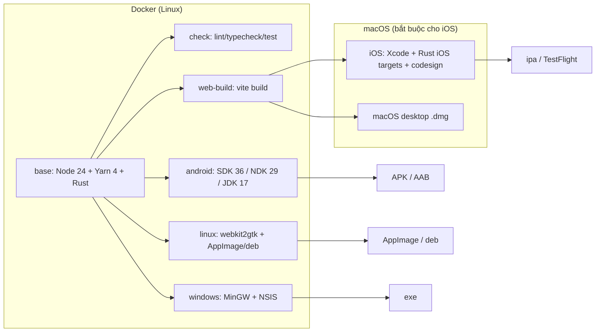

# Spec: Docker hóa build & dev cho Anomaly Client (Desktop + Mobile)

- **Trạng thái:** Draft
- **Ngày:** 2026-10-22
- **Phạm vi:** `client/` (mobile + desktop), CI/CD, tài liệu vận hành
- **Không thuộc phạm vi:** backend `server/`, `kyc-service/`, thay đổi nghiệp vụ app
- **Tài liệu liên quan:** `client/README.md`, `client/mobile/docs/android.md`, `client/flake.nix`, `client/Makefile`, `.github/workflows/ci-fe.yml`

---

## TL;DR

- **Android, Linux desktop, Windows desktop:** build 100% trong Docker trên Linux.
- **iOS (và macOS desktop):** **không thể** build trong Docker/Linux — bắt buộc macOS + Xcode. Docker chỉ đảm nhận phần web bundle và toolchain dùng chung; bước compile/ký iOS chạy trên GitHub Actions `macos-15` hoặc Mac.
- **Không dùng** `osxcross`/macOS trong container: vi phạm license Apple, không ký được, không có simulator.
- **Kế hoạch:** 5 phase, 8–12 ngày; Docker là môi trường chính, Nix giữ làm fallback.
- **Cần chốt trước khi làm:** iOS runner (mục 10), phạm vi desktop, store phát hành.

---

## 1. Mục tiêu

1. Một lệnh duy nhất để build/dev cả desktop và mobile, không cần cài Node, Rust, JDK, Android SDK/NDK trên máy dev — chỉ cần **Docker Engine + Docker Compose**.
2. Tái lập được môi trường build giữa máy dev, CI và máy release.
3. Sinh được artifact:
   - Android: APK debug, APK/AAB release.
   - Linux desktop: AppImage + `.deb`.
   - Windows desktop: `.exe` (NSIS) — cross-compile từ Linux container.
   - iOS: `.ipa` (simulator + device/TestFlight).
4. Giữ nguyên trải nghiệm hiện tại: `make -C client <target>`, `yarn lint/typecheck/test`, cổng 1420/1422, `.env` với `VITE_API_ENDPOINT`.
5. Thay dần Nix bằng Docker làm môi trường chính, nhưng **không xóa Nix ngay** (fallback trong ít nhất một chu kỳ release).

## 2. Quyết định cốt lõi (đọc trước khi implement)

### 2.1 Docker là môi trường build/dev, không phải runtime mobile

App vẫn là ứng dụng native Tauri cài lên thiết bị/emulator. Docker không "chạy app trên Android/iOS" thay thiết bị. Giá trị của Docker là:

- đóng gói toolchain (Node, Rust, JDK, SDK/NDK, Gradle, MinGW, NSIS);
- build ra artifact tái lập được;
- chuẩn hóa CI.

### 2.2 iOS **không thể** build trong Linux container

Đây là ràng buộc của Apple, không phải giới hạn công cụ:

- iOS cần **Xcode + iOS SDK + codesign**, chỉ chạy trên macOS.
- Apple không cho phân phối/self-host iOS SDK; chạy macOS trên phần cứng không phải Apple vi phạm license.
- `osxcross` chỉ dùng được nếu có SDK lấy từ máy Mac, không ký được, không có simulator, và Tauri không hỗ trợ chính thức → **loại bỏ**.
- Docker Desktop trên macOS chạy Linux VM, **không truy cập được Xcode** bên trong container.

**Kết luận:** "iOS qua Docker" được đáp ứng ở mức:

| Thành phần iOS | Nơi chạy |
| --- | --- |
| Cài dependency, build web bundle (`vite build`), lint/test | Docker (Linux) |
| Generate project, compile Rust → iOS, link, ký, archive, upload TestFlight | **macOS runner** (GitHub Actions `macos-15`, Mac self-hosted, hoặc cloud Mac) |

Nếu yêu cầu tuyệt đối là "không có macOS ở bất kỳ đâu", thì phạm vi phải bỏ iOS. Spec này chọn hướng **macOS runner cho bước iOS**, phần còn lại Docker hóa.

### 2.3 Ma trận nền tảng

| Target | Build trong Docker Linux | Ghi chú |
| --- | --- | --- |
| Android APK/AAB | ✅ | JDK 17 + SDK 36 + build-tools 35 + NDK 29 + Rust Android targets |
| Linux desktop (AppImage/deb) | ✅ | webkit2gtk-4.1, chạy được trên Ubuntu 22.04/24.04 |
| Windows desktop (NSIS) | ✅ (cross) | `x86_64-pc-windows-gnu` + MinGW + NSIS; native Windows runner vẫn ưu tiên cho release |
| iOS | ❌ | macOS + Xcode bắt buộc |
| macOS desktop | ❌ | macOS + Xcode bắt buộc |

### 2.4 Vì sao không chỉ dùng Nix?

Nix hiện tại đã giải quyết tốt tính tái lập nhưng có chi phí:

- người mới phải cài Nix, bật flakes, hiểu `nix develop`;
- CI GitHub Actions không có Nix sẵn (phải thêm installer);
- cache Nix/Cachix phụ thuộc hạ tầng ngoài;
- NixOS-specific (webkitgtk path, `nix-ld`) gây khó khi onboard.

Docker phổ biến hơn, nhưng **không thay thế được** macOS. Kế hoạch: Docker là mặc định; Nix giữ song song đến khi Docker ổn định trên CI và có tài liệu migration.

## 3. Hiện trạng repo (facts dùng cho thiết kế)

- Yarn 4 workspace tại `client/`, `nodeLinker: node-modules`.
- `client/vite.config.ts`: mobile 1420 (HMR 1421), desktop 1422 (HMR 1423), đọc `TAURI_DEV_HOST`.
- `client/mobile/src-tauri`:
  - `gen/android` đã commit; `minSdk 24`, `targetSdk 36`, `buildTools 35.0.0`.
  - `gen/apple` **chưa có** → phải `tauri ios init` trên macOS và commit.
  - Android manifest đã có `INTERNET`, `CAMERA`.
- `client/desktop/src-tauri/tauri.conf.json`: `bundle.active = false` → phải bật khi build release.
- `client/flake.nix`:
  - shell `default` (Linux desktop), `windows` (MinGW cross), `android` (JDK 17, SDK 36, NDK 29, `TAURI_ANDROID_AAPT2`).
  - Đây là nguồn version chính xác để đưa vào Dockerfile.
- `client/Makefile`: `emulator`, `android`, `desktop`; Android dùng `adb reverse tcp:8080` + `tcp:8090`.
- CI frontend hiện chỉ chạy lint/typecheck/test trên Node 24, chưa build native.
- Host dev hiện tại: NixOS x86_64, có Docker 29 và `/dev/kvm`.

## 4. Kiến trúc đề xuất

### 4.1 Sơ đồ



### 4.2 Cấu trúc file sẽ thêm

```text
client/
  docker/
    client.Dockerfile        # multi-stage: base → web → linux → android → windows
    entrypoint.sh            # chuẩn hóa uid/gid, corepack, chờ adb
    android-packages.txt     # pin SDK/build-tools/NDK
  compose.yaml
  scripts/
    android-dev.sh
    collect-artifacts.sh
  .dockerignore
.github/workflows/
  ci-client-container.yml    # build image + lint/typecheck/test trong container
  release-client.yml         # matrix: android, linux, windows, ios (macOS)
```

Không đặt Dockerfile trong `src-tauri/` để tránh Tauri CLI quét nhầm; context build là `client/`.

### 4.3 Multi-stage Dockerfile (phác thảo)

```dockerfile
# client/docker/client.Dockerfile
ARG NODE_VERSION=24
FROM node:${NODE_VERSION}-bookworm-slim AS base

ENV DEBIAN_FRONTEND=noninteractive
RUN apt-get update && apt-get install -y --no-install-recommends \
    ca-certificates curl git pkg-config libssl-dev \
    build-essential file && rm -rf /var/lib/apt/lists/*

# Rust stable; pin bằng rust-toolchain.toml nếu cần tái lập tuyệt đối
RUN curl --proto '=https' --tlsv1.2 -sSf https://sh.rustup.rs \
    | sh -s -- -y --profile minimal
ENV PATH=/root/.cargo/bin:$PATH

RUN corepack enable
WORKDIR /workspace/client
COPY package.json yarn.lock .yarnrc.yml ./
COPY mobile/package.json ./mobile/
COPY desktop/package.json ./desktop/
RUN yarn install --immutable

# ---------- web: lint/test/build ----------
FROM base AS web
COPY . .
CMD ["yarn", "lint"]

# ---------- linux desktop ----------
FROM base AS linux
RUN apt-get update && apt-get install -y --no-install-recommends \
    libwebkit2gtk-4.1-dev libgtk-3-dev libayatana-appindicator3-dev \
    librsvg2-dev libxdo-dev libsoup-3.0-dev && rm -rf /var/lib/apt/lists/*
COPY . .
CMD ["yarn", "workspace", "anomaly-desktop", "tauri", "build", "--bundles", "appimage,deb"]

# ---------- android ----------
FROM base AS android
ARG ANDROID_SDK_ROOT=/opt/android-sdk
ARG NDK_VERSION=29.0.14206865
ARG BUILD_TOOLS=35.0.0
RUN apt-get update && apt-get install -y --no-install-recommends \
    openjdk-17-jdk-headless unzip && rm -rf /var/lib/apt/lists/*
# cmdline-tools + sdkmanager, accept licenses, cài platform 36 / build-tools 35 / ndk 29
# ENV ANDROID_HOME, ANDROID_SDK_ROOT, NDK_HOME, JAVA_HOME, TAURI_ANDROID_AAPT2
RUN rustup target add aarch64-linux-android armv7-linux-androideabi \
    i686-linux-android x86_64-linux-android
COPY . .
CMD ["yarn", "workspace", "anomaly-mobile", "tauri", "android", "build", "--apk"]

# ---------- windows cross ----------
FROM base AS windows
RUN rustup target add x86_64-pc-windows-gnu
RUN apt-get update && apt-get install -y --no-install-recommends \
    gcc-mingw-w64-x86-64 nsis && rm -rf /var/lib/apt/lists/*
ENV CARGO_BUILD_TARGET=x86_64-pc-windows-gnu
ENV CARGO_TARGET_X86_64_PC_WINDOWS_GNU_LINKER=x86_64-w64-mingw32-gcc
COPY . .
CMD ["yarn", "workspace", "anomaly-desktop", "tauri", "build"]
```

Yêu cầu bổ sung:

- Dùng **BuildKit cache mount** cho `apt`, Cargo registry, Gradle, Yarn cache để giảm thời gian cold build.
- Pin version SDK/NDK/build-tools đúng như `flake.nix`; không dùng `latest`.
- Nếu base Debian thiếu `libwebkit2gtk-4.1-dev`, đổi stage `linux` sang `ubuntu:24.04` và copy Node/Rust từ `base`.
- Tạo user `dev` với `ARG UID/GID` để file sinh ra không thuộc root (đặc biệt `gen/android`, `target/`, `dist/`).
- `.dockerignore`: `node_modules`, `*/dist`, `*/src-tauri/target`, `*/src-tauri/gen/*/build`, `.env`, `*.keystore`, `*.jks`.

### 4.4 Compose (phác thảo)

```yaml
# client/compose.yaml
name: anomaly-client

x-build: &build
  context: .
  dockerfile: docker/client.Dockerfile
  args:
    UID: ${UID:-1000}
    GID: ${GID:-1000}

x-client: &client
  build:
    <<: *build
  working_dir: /workspace/client
  volumes:
    - .:/workspace/client
    - cargo-registry:/home/dev/.cargo/registry
    - cargo-git:/home/dev/.cargo/git
    - gradle-cache:/home/dev/.gradle
    - android-home:/home/dev/.android
  env_file:
    - path: .env
      required: false

services:
  check:
    <<: *client
    profiles: ["check"]
    build:
      <<: *build
      target: web
    command: sh -c "yarn lint && yarn typecheck && yarn test"

  android-build:
    <<: *client
    profiles: ["android"]
    build:
      <<: *build
      target: android
    command: ["yarn", "workspace", "anomaly-mobile", "tauri", "android", "build", "--apk"]

  # Dev loop: cần emulator/thiết bị + adb server trên host
  android-dev:
    <<: *client
    profiles: ["android"]
    build:
      <<: *build
      target: android
    network_mode: host          # Linux; macOS/Windows xem mục 5.2
    environment:
      ADB_SERVER_SOCKET: tcp:127.0.0.1:5037
      TAURI_DEV_HOST: 127.0.0.1
    command: ["yarn", "workspace", "anomaly-mobile", "tauri", "android", "dev"]

  linux-build:
    <<: *client
    profiles: ["desktop"]
    build:
      <<: *build
      target: linux
    command: ["yarn", "workspace", "anomaly-desktop", "tauri", "build", "--bundles", "appimage,deb"]

  windows-build:
    <<: *client
    profiles: ["desktop"]
    build:
      <<: *build
      target: windows
    command: ["yarn", "workspace", "anomaly-desktop", "tauri", "build"]

volumes:
  cargo-registry:
  cargo-git:
  gradle-cache:
  android-home:
```

Ghi chú:

- `network_mode: host` chỉ dùng cho dev Android trên Linux. Trên macOS/Windows, đổi sang `ADB_SERVER_SOCKET=tcp:host.docker.internal:5037` + `extra_hosts` (xem mục 5.1).
- Artifact được copy ra `client/artifacts/<target>/` bằng `scripts/collect-artifacts.sh` (mount `./artifacts`), không để lẫn trong `target/`.
- `check` không mount source nếu muốn test image sạch; mặc định mount để có cache và sửa code nhanh.

### 4.5 Makefile (giữ API hiện tại)

```make
# client/Makefile
docker-check:
	docker compose --profile check run --rm check

docker-android:
	docker compose --profile android run --rm android-build

docker-android-dev:
	docker compose --profile android up android-dev

docker-desktop:
	docker compose --profile desktop run --rm linux-build

docker-windows:
	docker compose --profile desktop run --rm windows-build
```

Giữ nguyên `make emulator`, `make android`, `make desktop` cho người dùng Nix; thêm biến `CLIENT_ENV=docker|nix` (mặc định `docker`) để chuyển dần, tránh breaking workflow hiện tại.

## 5. Luồng dev

### 5.1 Android — emulator trên host (khuyến nghị)

Lý do: emulator cần KVM + gia tốc GPU + webcam (KYC camera); chạy trên host ổn định hơn trong container.

```bash
# Terminal 1 (host)
adb start-server              # adb server dùng chung với container
make -C client emulator      # giữ nguyên flow Nix hiện tại

# Terminal 2
cd client
docker compose --profile android run --rm android-build   # build APK
# cài APK: adb install -r mobile/src-tauri/gen/android/app/build/outputs/apk/universal/release/app-universal-release.apk
# hoặc dev loop có HMR:
docker compose --profile android up android-dev
```

Yêu cầu:

- `adb reverse tcp:8080 tcp:8080`, `tcp:8090 tcp:8090`, `tcp:1420 tcp:1420` và `tcp:1421 tcp:1421` chạy trước khi app khởi động (script `android-dev.sh` làm việc này qua adb server của host).
- Vite phải bind ra ngoài container; với `network_mode: host` + `adb reverse tcp:1420`, app load `http://localhost:1420`.
- Nếu dùng thiết bị thật qua USB: ưu tiên chia sẻ **adb server của host**; chỉ mount `/dev/bus/usb` khi thật cần (phân quyền udev phức tạp).
- `.env`:
  - emulator + `adb reverse`: `VITE_API_ENDPOINT=http://localhost:8080` (như hiện tại).
  - không dùng reverse: `http://10.0.2.2:8080` cho emulator, hoặc IP LAN cho máy thật.
  - production: HTTPS, `VITE_API_ENDPOINT` bắt buộc (code đã throw nếu thiếu).

### 5.2 Android — emulator trong container (tùy chọn, không bắt buộc)

Chỉ dùng cho CI headless hoặc spike:

- `devices: ["/dev/kvm"]`, image có `emulator` + system image API 33.
- Cần X11 socket (`/tmp/.X11-unix`, `$XAUTHORITY`) hoặc chạy `-no-window` + `adb exec-out screencap`.
- Không test được camera thật; dùng `-camera-front emulated`.
- Tăng dung lượng image ~2 GB; không đưa vào image mặc định.

Quyết định: **không** container hóa emulator trong phạm vi MVP; ghi lại như backlog.

### 5.3 Linux desktop

Hai chế độ:

1. **Build trong container, chạy trên host** (khuyến nghị cho release):
   - `docker compose --profile desktop run --rm linux-build`
   - Artifact: `client/artifacts/linux/*.AppImage`, `*.deb`.
2. **Dev loop trong container** (khi host là NixOS):
   - mount `/tmp/.X11-unix`, `$XAUTHORITY`, `DISPLAY`;
   - `--device /dev/dri` (nếu có) và `WEBKIT_DISABLE_DMABUF_RENDERER=1`;
   - Wayland: dùng XWayland.
   - Cảnh báo: AppImage build trên Ubuntu có thể không chạy trực tiếp trên NixOS (không có FHS). Trên NixOS, chạy trong container hoặc dùng `nix-ld`/`appimage-run`.

Cần bật bundle cho desktop:

```json
// client/desktop/src-tauri/tauri.conf.json
"bundle": { "active": true, "targets": ["appimage", "deb"] }
```

### 5.4 Windows desktop

- MVP: cross-compile trong container (MinGW + NSIS), artifact `.exe`.
- Release chính thức: build trên `windows-latest` để tránh sai khác runtime/WebView2 và dễ ký số.
- Không dùng Windows container: Docker Linux không chạy được Windows GUI container, và Tauri không hỗ trợ.

### 5.5 iOS

**Dev local (bắt buộc macOS):**

```bash
# Trên Mac có Xcode 16+, Rust, Node 24
cd client
corepack enable && yarn install --immutable
yarn workspace anomaly-mobile tauri ios init   # một lần, commit gen/apple
yarn workspace anomaly-mobile tauri ios dev    # simulator/device
```

**CI (khuyến nghị):**

- Job `ios` trên `macos-15`:
  - checkout, setup Node 24 + Corepack, `yarn install --immutable`;
  - `rustup target add aarch64-apple-ios aarch64-apple-ios-sim`;
  - `yarn workspace anomaly-mobile tauri ios build --export-method app-store-connect`;
  - ký bằng `APPLE_CERTIFICATE`, `APPLE_CERTIFICATE_PASSWORD`, `APPLE_SIGNING_IDENTITY`, `APPLE_TEAM_ID`, provisioning profile (hoặc App Store Connect API key + fastlane);
  - upload TestFlight bằng `xcrun altool`/`fastlane pilot` (chỉ trên tag).
- Docker job `web` build bundle trước nếu muốn tách: artifact `dist/` được upload rồi job macOS chỉ compile Rust + ký. Cách này giảm thời gian macOS nhưng tăng độ phức tạp; MVP làm tất cả trên macOS cho đơn giản.

**Signing:**

- Không bake certificate/keystore vào image.
- GitHub Secrets + keychain tạm trong job; keystore Android mount từ secret file khi build release.
- `gen/apple` commit phần project, **không** commit certificate/provisioning.

## 6. CI/CD

### 6.1 Pull request

| Job | Runner | Nội dung |
| --- | --- | --- |
| `client-checks` | ubuntu-latest (container image) | lint, typecheck, test trong Docker |
| `android-debug` | ubuntu-latest | build APK debug, upload artifact |
| `linux-build` | ubuntu-latest | AppImage/deb (có thể chỉ trên main để tiết kiệm) |
| `ios-sim` | macos-15 | build simulator, **không ký**, chỉ chạy khi `client/**` thay đổi |

### 6.2 Release (tag `v*`)

| Job | Runner | Artifact |
| --- | --- | --- |
| Android | ubuntu-latest + Docker | `.apk`, `.aab` đã ký |
| Linux | ubuntu-latest + Docker | `.AppImage`, `.deb` |
| Windows | windows-latest (hoặc Docker cross) | `.exe` NSIS |
| iOS | macos-15 | `.ipa` + TestFlight |
| macOS desktop | macos-15 | `.dmg` (nếu cần) |

Yêu cầu:

- Cache BuildKit (`type=gha`), Cargo (`Swatinem/rust-cache`), Gradle.
- `concurrency` theo ref, timeout 45–60 phút/job.
- Không upload artifact chứa `.env`, keystore, certificate.
- Checksum SHA256 cho từng artifact.

## 7. Kế hoạch triển khai

### Phase 0 — Chuẩn bị (0.5–1 ngày)

- Chốt các quyết định ở mục 10.
- Tạo `client/docker/client.Dockerfile` stage `web`, `client/compose.yaml`, `.dockerignore`.
- `docker compose --profile check run --rm check` chạy xanh.
- **DoD:** lint/typecheck/test chạy trong container trên máy sạch, không cần Node/Rust host.

### Phase 1 — Android (2–3 ngày)

- Stage `android`: JDK 17, SDK 36, build-tools 35.0.0, NDK 29, Rust targets.
- Build APK debug; cài lên emulator host; xác nhận màn hình login/"Hello Anomaly".
- Dev loop: `android-dev` + `adb reverse` + HMR.
- Script `android-dev.sh` tự động reverse 8080/8090/1420/1421.
- **DoD:** `make docker-android` sinh APK; `make docker-android-dev` có HMR; app gọi được API local; file không thuộc root.

### Phase 2 — Linux desktop (1–2 ngày)

- Stage `linux`; bật `bundle.active`; build AppImage + deb.
- Smoke test artifact trên Ubuntu 24.04 (VM/CI).
- Tùy chọn: dev container với X11 cho NixOS.
- **DoD:** artifact chạy được, kết nối API, bundle icon đúng.

### Phase 3 — Windows (1–2 ngày)

- Stage `windows` với MinGW + NSIS; build `.exe`.
- So sánh với build native `windows-latest`; chọn phương án release.
- **DoD:** `.exe` cài được trên Windows 11, app mở và gọi API.

### Phase 4 — iOS (2–3 ngày)

- Trên Mac: `tauri ios init`, commit `gen/apple`, chạy simulator.
- Thêm job `ios-sim` cho PR.
- Thêm job release ký + TestFlight trên tag.
- **DoD:** PR build simulator xanh; tag tạo `.ipa` và upload TestFlight thành công.

### Phase 5 — CI, docs, migration (1 ngày)

- `ci-client-container.yml`, `release-client.yml`.
- Cập nhật `client/README.md`, `client/mobile/docs/android.md`, thêm `docs/docker.md`.
- Ghi rõ Nix là legacy/fallback; lộ trình xóa sau 1–2 release.
- **DoD:** tài liệu đủ để người mới onboard chỉ với Docker (+ macOS cho iOS).

**Tổng ước lượng:** 8–12 ngày làm việc, chưa gồm thời gian chờ Apple review/App Store Connect.

## 8. Acceptance criteria

1. Máy Linux x86_64 chỉ có Docker + Make:
   - `make -C client docker-check` → xanh.
   - `make -C client docker-android` → APK debug cài được lên emulator.
   - `make -C client docker-desktop` → AppImage + deb chạy được.
2. Cold build Android ≤ 40 phút; warm build (cache) ≤ 10 phút trên máy 8 core/16 GB.
3. Image `android` ≤ 4 GB compressed; `linux` ≤ 2.5 GB.
4. Không có file `node_modules`, `target`, `dist`, `gen/android` bị đổi owner sang root sau khi chạy container.
5. Dev loop Android có HMR ≤ 3 giây sau khi sửa file TSX.
6. CI PR: check + Android debug + iOS simulator hoàn tất ≤ 30 phút (song song).
7. Release tag tạo đủ artifact cho 4 nền tảng (Android, Linux, Windows, iOS), có checksum.
8. Không có secret (keystore, certificate, `.env`) trong image/artifact/log.
9. Tài liệu: một lệnh cho mỗi target; troubleshooting cho ADB, KVM, X11, signing.

## 9. Rủi ro & giảm thiểu

| Rủi ro | Mức | Giảm thiểu |
| --- | --- | --- |
| iOS không build được trên Linux | Cao | macOS runner; nói rõ trong tài liệu; không hứa "iOS trong Docker" |
| Apple signing/2FA, certificate hết hạn | Cao | App Store Connect API key, fastlane match, lịch nhắc renew |
| Docker image quá lớn, đầy disk | Trung bình | multi-stage, cache mount, `docker image prune`, tách image theo target |
| ADB/HMR không kết nối | Trung bình | `network_mode: host`, chia sẻ adb server, script reverse tự động, healthcheck |
| AppImage không chạy trên NixOS | Trung bình | chạy trong container hoặc `appimage-run`; ghi chú rõ |
| WebKit version lệch distro | Trung bình | pin Ubuntu 24.04, test trên distro đích, không build trên rolling |
| Emulator cần KVM/camera | Trung bình | emulator trên host; CI dùng `-no-window`, camera emulated |
| Gradle/SDK download lỗi mạng | Trung bình | prebake SDK trong image, retry, cache layer |
| Apple Silicon + Android emulator x86_64 | Trung bình | dùng ARM system image hoặc emulator trên host |
| Rò rỉ secret qua build args/layer | Cao | secret chỉ mount runtime; `.dockerignore`; quét image |
| License Apple/Android SDK | Cao | không redistribute SDK; chỉ dùng trong CI nội bộ |
| Tauri/NDK/Gradle version drift | Trung bình | pin version trong Dockerfile + `Cargo.lock` + `yarn.lock`; renovate có kiểm soát |

## 10. Quyết định cần chốt

1. **iOS runner:** GitHub Actions `macos-15` (khuyến nghị) / Mac self-hosted / cloud Mac (Codemagic, Bitrise)? Có ngân sách macOS minutes không?
2. **Nix:** giữ song song bao lâu? Có xóa `flake.nix` sau Phase 5 không?
3. **Desktop release:** chỉ Linux, hay bắt buộc Windows + macOS?
4. **Store:** phát hành Play Console/App Store hay chỉ nội bộ (APK/IPA + TestFlight)?
5. **Chữ ký:** ai giữ Apple Developer account, keystore Android, và quy trình rotate?
6. **Min OS:** Android 24 (hiện tại) và iOS tối thiểu bao nhiêu? (cần xác nhận theo version Tauri 2 đang dùng)
7. **Camera/KYC:** có cần test trên thiết bị thật trong CI không, hay chỉ smoke test thủ công?
8. **Registry:** lưu image ở GHCR hay registry nội bộ? Có mirror cho mạng hạn chế?
9. **Dev trên NixOS:** chấp nhận chạy desktop trong container + X11, hay giữ Nix cho desktop dev?

## 11. Phương án đã cân nhắc

| Phương án | Ưu | Nhược | Kết luận |
| --- | --- | --- | --- |
| **Docker + macOS runner** (đề xuất) | Tái lập, phổ biến, CI tốt, iOS hợp pháp | 2 môi trường; chi phí macOS | Chọn |
| Nix thuần (hiện tại) | Tái lập cao, đã chạy | Onboard khó, CI lệch, không iOS | Giữ fallback |
| Docker thuần + osxcross | Một môi trường Linux | Vi phạm license, không ký/simulator, không support | Loại |
| Chuyển sang React Native/Expo | Build iOS cloud dễ hơn | Viết lại app, mất Tauri/Rust | Loại |
| Chỉ CI cloud (Codemagic) cho mọi target | Ít hạ tầng | Khóa nhà cung cấp, khó dev local | Không chọn làm mặc định |

## 12. Deliverables

- `client/docker/client.Dockerfile`, `client/compose.yaml`, `client/.dockerignore`.
- `client/scripts/android-dev.sh`, `client/scripts/collect-artifacts.sh`.
- Makefile targets mới (không phá target cũ).
- `.github/workflows/ci-client-container.yml`, `.github/workflows/release-client.yml`.
- `client/docs/docker.md` + cập nhật README.
- `client/mobile/src-tauri/gen/apple` (commit, sinh trên macOS).
- Bật `bundle.active` cho desktop và cấu hình signing Android/iOS.

---

## Phụ lục A — Lệnh mục tiêu sau khi hoàn thành

```bash
# Kiểm tra frontend trong container
make -C client docker-check

# Android
make -C client emulator              # host, giữ nguyên
make -C client docker-android        # build APK + cài
make -C client docker-android-dev    # dev + HMR

# Desktop
make -C client docker-desktop        # AppImage + deb
make -C client docker-windows        # exe (cross)

# iOS (trên macOS hoặc CI)
cd client && yarn workspace anomaly-mobile tauri ios build --export-method app-store-connect
```

## Phụ lục B — Checklist onboarding máy mới (Linux)

```bash
# 1. Docker + compose plugin
docker --version && docker compose version

# 2. Quyền KVM cho emulator (nếu chạy emulator trên host)
ls -l /dev/kvm && groups | grep -q kvm

# 3. Clone + cấu hình
git clone <repo> && cd anomaly/client
cp .env.example .env

# 4. Kiểm tra
make docker-check

# 5. Build
make docker-android
make docker-desktop
```

## Phụ lục C — Checklist macOS/iOS

```bash
xcodebuild -version          # Xcode 16+
xcode-select -p
rustup target list --installed | grep apple-ios
cd client && yarn install --immutable
yarn workspace anomaly-mobile tauri ios init   # lần đầu
yarn workspace anomaly-mobile tauri ios dev
```

Yêu cầu tài khoản Apple Developer, App ID `com.dontwait.client`, provisioning profile và certificate distribution; lưu trong GitHub Secrets, không commit.
